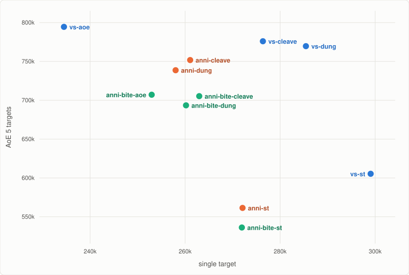

Devourer Demon Hunter, Midnight 12.1.5.

`devourer.simc` carries Void-Scarred and Annihilator gear and single-target talents; Void-Scarred is live and the rest is commented out below it.
Simmed at target_error 0.05.

## ST: 1 target, 300s, lust ([report](https://www.raidbots.com/simbot/report/ef3AUtYg9NngnQZ39S85ri))

| Build | DPS | Build report |
|---|---|---|
| vs-st | 295,391 | [report](https://www.raidbots.com/simbot/report/qbk1kgXJqcC4GrZ2vq6HGE) |
| vs-dung | 286,175 | [report](https://www.raidbots.com/simbot/report/xrJwEvYsTKm65adHHti6Pp) |
| vs-cleave | 276,326 | [report](https://www.raidbots.com/simbot/report/kHBoTbWpQD54sbzjwkmTb4) |
| anni-st | 272,220 | [report](https://www.raidbots.com/simbot/report/5MvtdZ6yi5sjWHLWQETZ7P) |
| anni-bite-st | 271,912 | [report](https://www.raidbots.com/simbot/report/kEA4xAyqfGL7ZHMk86dGKr) |
| anni-bite-cleave | 262,926 | [report](https://www.raidbots.com/simbot/report/tpbvJryWKSAyzQtQepRLWd) |
| anni-cleave | 261,025 | [report](https://www.raidbots.com/simbot/report/xnDLmnaAqFoZWnSSm3ZmNM) |
| anni-bite-dung | 260,228 | [report](https://www.raidbots.com/simbot/report/evQvHDpRNnpg17KfV9uM2h) |
| anni-dung | 258,087 | [report](https://www.raidbots.com/simbot/report/397y7Ajv27wCg7eCRCLgCj) |
| anni-bite-aoe | 253,024 | [report](https://www.raidbots.com/simbot/report/qq9wgnqygsGKosaT9SoNwc) |
| vs-aoe | 234,635 | [report](https://www.raidbots.com/simbot/report/r4usm2WGDgoeqX7tLQS15P) |

## Cleave: 3 targets, 300s, lust ([report](https://www.raidbots.com/simbot/report/fcLnCr6A9j7wwb9xK3PZ5E))

| Build | DPS | Build report |
|---|---|---|
| vs-cleave | 556,013 | [report](https://www.raidbots.com/simbot/report/kHBoTbWpQD54sbzjwkmTb4) |
| vs-dung | 553,256 | [report](https://www.raidbots.com/simbot/report/xrJwEvYsTKm65adHHti6Pp) |
| anni-cleave | 548,151 | [report](https://www.raidbots.com/simbot/report/xnDLmnaAqFoZWnSSm3ZmNM) |
| anni-dung | 539,675 | [report](https://www.raidbots.com/simbot/report/397y7Ajv27wCg7eCRCLgCj) |
| anni-bite-cleave | 520,206 | [report](https://www.raidbots.com/simbot/report/tpbvJryWKSAyzQtQepRLWd) |
| anni-bite-dung | 512,320 | [report](https://www.raidbots.com/simbot/report/evQvHDpRNnpg17KfV9uM2h) |
| vs-aoe | 499,742 | [report](https://www.raidbots.com/simbot/report/r4usm2WGDgoeqX7tLQS15P) |
| anni-bite-aoe | 476,843 | [report](https://www.raidbots.com/simbot/report/qq9wgnqygsGKosaT9SoNwc) |
| vs-st | 475,753 | [report](https://www.raidbots.com/simbot/report/qbk1kgXJqcC4GrZ2vq6HGE) |
| anni-st | 449,965 | [report](https://www.raidbots.com/simbot/report/5MvtdZ6yi5sjWHLWQETZ7P) |
| anni-bite-st | 434,599 | [report](https://www.raidbots.com/simbot/report/kEA4xAyqfGL7ZHMk86dGKr) |

## AoE: 5 targets, 300s, lust ([report](https://www.raidbots.com/simbot/report/7PtJiRy1iwhFhp3wjrNemb))

| Build | DPS | Build report |
|---|---|---|
| vs-aoe | 795,310 | [report](https://www.raidbots.com/simbot/report/r4usm2WGDgoeqX7tLQS15P) |
| vs-cleave | 774,744 | [report](https://www.raidbots.com/simbot/report/kHBoTbWpQD54sbzjwkmTb4) |
| vs-dung | 768,131 | [report](https://www.raidbots.com/simbot/report/xrJwEvYsTKm65adHHti6Pp) |
| anni-cleave | 752,057 | [report](https://www.raidbots.com/simbot/report/xnDLmnaAqFoZWnSSm3ZmNM) |
| anni-dung | 739,105 | [report](https://www.raidbots.com/simbot/report/397y7Ajv27wCg7eCRCLgCj) |
| anni-bite-aoe | 707,428 | [report](https://www.raidbots.com/simbot/report/qq9wgnqygsGKosaT9SoNwc) |
| anni-bite-cleave | 705,366 | [report](https://www.raidbots.com/simbot/report/tpbvJryWKSAyzQtQepRLWd) |
| anni-bite-dung | 693,410 | [report](https://www.raidbots.com/simbot/report/evQvHDpRNnpg17KfV9uM2h) |
| vs-st | 569,238 | [report](https://www.raidbots.com/simbot/report/qbk1kgXJqcC4GrZ2vq6HGE) |
| anni-st | 561,503 | [report](https://www.raidbots.com/simbot/report/5MvtdZ6yi5sjWHLWQETZ7P) |
| anni-bite-st | 536,331 | [report](https://www.raidbots.com/simbot/report/kEA4xAyqfGL7ZHMk86dGKr) |

## Dungeon: Temple of Sethraliss route, +20 keystone ([report](https://www.raidbots.com/simbot/report/j3ekGrUJ9hoSeYjtpVzcfe))

`temple-of-sethraliss-route.simc` walks a Temple of Sethraliss M+ route end to end. The pulls,
the chaining and the mob health all come off 12.1 PTR logs, scaled down to one actor, with health
at a +20 keystone. Run it with:

    simc devourer.simc temple-of-sethraliss-route.simc

| Build | DPS | Build report |
|---|---|---|
| vs-dung | 638,470 | [report](https://www.raidbots.com/simbot/report/xrJwEvYsTKm65adHHti6Pp) |
| vs-cleave | 637,695 | [report](https://www.raidbots.com/simbot/report/kHBoTbWpQD54sbzjwkmTb4) |
| anni-dung | 629,152 | [report](https://www.raidbots.com/simbot/report/397y7Ajv27wCg7eCRCLgCj) |
| anni-cleave | 620,364 | [report](https://www.raidbots.com/simbot/report/xnDLmnaAqFoZWnSSm3ZmNM) |
| anni-bite-dung | 618,395 | [report](https://www.raidbots.com/simbot/report/evQvHDpRNnpg17KfV9uM2h) |
| anni-bite-cleave | 608,240 | [report](https://www.raidbots.com/simbot/report/tpbvJryWKSAyzQtQepRLWd) |
| vs-aoe | 603,174 | [report](https://www.raidbots.com/simbot/report/r4usm2WGDgoeqX7tLQS15P) |
| anni-bite-aoe | 592,724 | [report](https://www.raidbots.com/simbot/report/qq9wgnqygsGKosaT9SoNwc) |
| anni-st | 547,003 | [report](https://www.raidbots.com/simbot/report/5MvtdZ6yi5sjWHLWQETZ7P) |
| vs-st | 538,693 | [report](https://www.raidbots.com/simbot/report/qbk1kgXJqcC4GrZ2vq6HGE) |
| anni-bite-st | 529,427 | [report](https://www.raidbots.com/simbot/report/kEA4xAyqfGL7ZHMk86dGKr) |

## Talent strings

| Build | Talent string | Report |
|---|---|---|
| vs-st | `CgcBAAAAAAAAAAAAAAAAAAAAAAAWMzMzMzMzMwMAAAAAAALzYMYGAAAAAAAAmxMMmZmZYmZYmlZGjNttAgAGAjZmZbmZa2mZbmhxMGA` | [report](https://www.raidbots.com/simbot/report/qbk1kgXJqcC4GrZ2vq6HGE) |
| vs-cleave | `CgcBAAAAAAAAAAAAAAAAAAAAAAAWMzMzMzMzMwMAAAAAAALzYMYGAAAAAAAAmxMMmZmZGzMDzsMDjNtsAgAGAjZmZZmZa2mZbmZwMGA` | [report](https://www.raidbots.com/simbot/report/kHBoTbWpQD54sbzjwkmTb4) |
| vs-aoe | `CgcBAAAAAAAAAAAAAAAAAAAAAAAWMzMzMzMzMwMAAAAAAALzYMYGAAAAAAAAmxMMzMzMzYmBzsMzYsplFAEwAMMzMLzMTz2MbGGGzA` | [report](https://www.raidbots.com/simbot/report/r4usm2WGDgoeqX7tLQS15P) |
| vs-dung | `CgcBAAAAAAAAAAAAAAAAAAAAAAAWMzMzMzMzMwMAAAAAAALzYMYGAAAAAAAAmxMMmZmZGzMDzsMzYsplFAEwAYMzMLzMTz2MbmZMmxA` | [report](https://www.raidbots.com/simbot/report/xrJwEvYsTKm65adHHti6Pp) |
| anni-st | `CgcBAAAAAAAAAAAAAAAAAAAAAAA2MmZmZmZmBzMAAAAAAALzYAzAAAAAAAAwMGMzMzMjZmZGzsYGjFtswMzMzWbzMzAYmZAIwDMGMMA` | [report](https://www.raidbots.com/simbot/report/5MvtdZ6yi5sjWHLWQETZ7P) |
| anni-cleave | `CgcBAAAAAAAAAAAAAAAAAAAAAAA2MmZmZmZmBzMAAAAAAALzYAzAAAAAAAAwMGMzMzMzMzMDzsYGjFZhZmZmt2mZmBwYGAC8AjZYMD` | [report](https://www.raidbots.com/simbot/report/xnDLmnaAqFoZWnSSm3ZmNM) |
| anni-dung | `CgcBAAAAAAAAAAAAAAAAAAAAAAA2MmZmZmZmBzMAAAAAAALzYAzAAAAAAAAwMGMzMzMzMzMDzsYGjFZhZmZmtWmZmBwYGAC8AjZYMD` | [report](https://www.raidbots.com/simbot/report/397y7Ajv27wCg7eCRCLgCj) |
| anni-bite-st | `CgcBAAAAAAAAAAAAAAAAAAAAAAA2MmZmZmZmBzMAAAAAAALzYAzAAAAAAAAwMGMmZmZMzMzYmFzYsolFmZmZ2abmZGAzMDABmZgZMA` | [report](https://www.raidbots.com/simbot/report/kEA4xAyqfGL7ZHMk86dGKr) |
| anni-bite-cleave | `CgcBAAAAAAAAAAAAAAAAAAAAAAA2MmZmZmZmBzMAAAAAAALzYAzAAAAAAAAwMGMPwMzMzMzMDzsYGjFZhZmZmt2mZmBwYGACMzMYGD` | [report](https://www.raidbots.com/simbot/report/tpbvJryWKSAyzQtQepRLWd) |
| anni-bite-aoe | `CgcBAAAAAAAAAAAAAAAAAAAAAAA2MmZmZmZmBzMAAAAAAALzYAzAAAAAAAAwMGMzMzMzMzMYmFzYsolFmZmZ2abmZGAjZAIwMDMjB` | [report](https://www.raidbots.com/simbot/report/qq9wgnqygsGKosaT9SoNwc) |
| anni-bite-dung | `CgcBAAAAAAAAAAAAAAAAAAAAAAA2MmZmZmZmBzMAAAAAAALzYAzAAAAAAAAwMGMPwMzMzMzMDzsYGjFZhZmZmtWmZmBwYGACMzMYGD` | [report](https://www.raidbots.com/simbot/report/evQvHDpRNnpg17KfV9uM2h) |

## Contributing

PRs welcome! If you beat one of these numbers include the profile changes and a Raidbots report at target_error 0.05.
